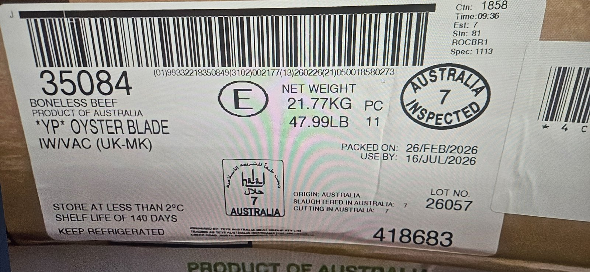
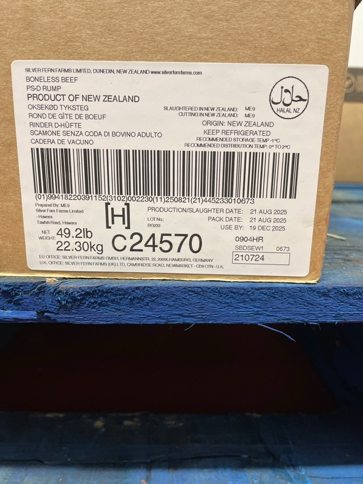
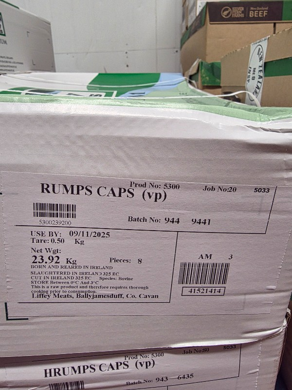
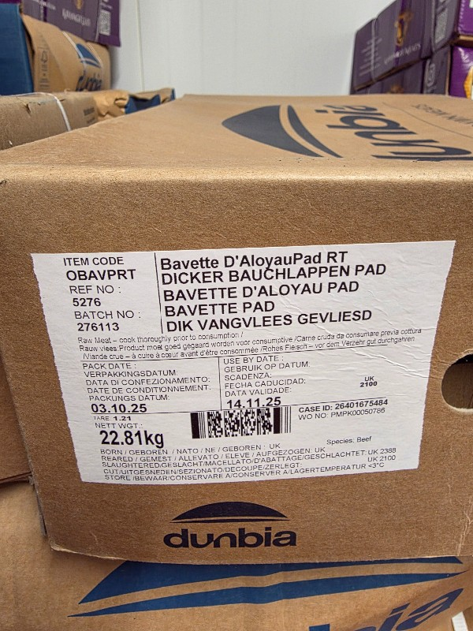

# Etiquetas dos fornecedores

Cada fornecedor imprime a etiqueta da caixa de um jeito. O LOTE reconhece o fornecedor pelo próprio código e aplica as regras do **perfil de etiqueta** dele (tabela `label_profiles`).

## Os três tipos de etiqueta

| Tipo                | Como é                                                      | O que o scan entrega                                           | Exemplo           |
| ------------------- | ----------------------------------------------------------- | -------------------------------------------------------------- | ----------------- |
| **GS1-128**         | Código padrão mundial, com identificadores entre parênteses | Produto, peso, data, serial (às vezes lote e validade)         | Teys, Silver Fern |
| **Código próprio**  | Formato do fornecedor, lido por posição                     | O que o fornecedor colocou (ex.: produto e peso)               | Liffey            |
| **Sem código útil** | Os dados só estão impressos                                 | Nada: foto + IA lendo o texto, com confirmação humana (futuro) | —                 |

## Identificadores GS1 que importam

| AI                         | Significado                                                                        | Formato                                   |
| -------------------------- | ---------------------------------------------------------------------------------- | ----------------------------------------- |
| `(01)`                     | Produto (GTIN-14). Começa com `9` = peso variável. Depois vem o prefixo da empresa | 14 dígitos                                |
| `(3101)` `(3102)` `(3103)` | Peso líquido em kg com 1, 2 ou 3 casas decimais                                    | 6 dígitos: `002177` com `3102` = 21,77 kg |
| `(3201)`…`(3203)`          | Peso em libras                                                                     | converter: × 0,45359237                   |
| `(11)`                     | Data de produção                                                                   | AAMMDD                                    |
| `(13)`                     | Data de embalagem                                                                  | AAMMDD                                    |
| `(15)` / `(17)`            | Consumir de preferência até / validade                                             | AAMMDD                                    |
| `(10)`                     | Lote                                                                               | texto variável                            |
| `(21)`                     | Serial da caixa (impede ler a mesma caixa duas vezes)                              | texto variável                            |

O último dígito do AI de peso diz as casas decimais. **Nunca** assuma um formato fixo.

## Fornecedores mapeados

### Teys Australia · GS1 ✅



- Reconhecimento: GTIN com prefixo `9332218` (`93` = GS1 Austrália)
- O código traz: produto, peso `(3102)`, embalagem `(13)`, serial `(21)`
- **Validade** = embalagem + **140 dias** (impresso "Shelf life of 140 days")
- **Lote** = ano (2 dígitos) + dia do ano. 26/02/2026 → `26057`
- Confirmado com 2 caixas: Oyster Blade (lote 26057, validade 16/07/2026) e Inside (lote 25223, validade 29/12/2025)
- Outros campos impressos: `Ctn` (número da caixa, aparece dentro do serial), `Est 7` (estabelecimento), `Spec` (especificação do corte)

```json
match: {"tipo":"gs1","prefixo_gtin":"9332218"}
rules: {"shelf_dias":140,"lote":{"regra":"aaddd"},"peso_kg":[10,35]}
```

### Silver Fern Farms (Nova Zelândia) · GS1 ✅



- Reconhecimento: prefixo `9418220` (`94` = GS1 Nova Zelândia)
- O código traz: produto, peso `(3102)`, **produção** `(11)`, serial `(21)`
- **Validade** = produção + **120 dias** (21/08/2025 → 19/12/2025, igual ao impresso)
- **Lote** = `BG` + dia do ano (233 → `BG233`)
- ⚠️ Confirmar com mais uma caixa se o prefixo `BG` é fixo

```json
match: {"tipo":"gs1","prefixo_gtin":"9418220"}
rules: {"shelf_dias":120,"lote":{"regra":"ddd","prefixo":"BG"},"peso_kg":[10,35]}
```

### Liffey Meats (Irlanda) · código próprio 🟡



- Dois códigos na etiqueta:
  - **Code 128** `5300239200` = produto `5300` + peso `2392` (23,92 kg) + `00`
  - **ITF** `9415214149` = número da caixa `41521414` (sem o primeiro dígito e o verificador)
- **Validade e lote não estão em nenhum código**: o app pede para digitar a validade
- ⚠️ Confirmar com outra caixa de peso diferente que os dígitos do meio mudam com o peso, e o que significam os dois `00` finais
- A foto é pequena: para ler o Liffey nas fotos de teste é preciso ampliar 2×

```json
match: {"tipo":"molde","chave":"liffey","padrao":"^\\d{10}$","produto":[0,4],"peso":[4,8],"casas":2,"serial_itf":true}
rules: {"peso_kg":[5,35]}
```

### Dunbia (Reino Unido/Irlanda) · pendente ❌



- Tem um código pequeno e denso e um "Case ID" de 11 dígitos
- Peso (22,81 kg), lote/batch (276113), embalagem (03/10/25) e validade (14/11/25) estão impressos
- **Falta:** foto nítida e de perto só do código de barras, enviada como documento no WhatsApp

## Como adicionar um fornecedor novo

1. Fotografe a etiqueta **de perto**, só a área do código, sem reflexo. Mande como **documento** (no WhatsApp, imagem é comprimida e as barras ficam ilegíveis)
2. Leia o código (pode usar o scanner do app) e compare com o que está impresso: onde estão o peso, a data, o lote?
3. Descubra a regra da validade: diferença em dias entre a data do código e a validade impressa. Confirme com **duas caixas**
4. Salve a foto em `docs/etiquetas/fotos/` e documente o fornecedor aqui
5. Adicione um teste em `lib/labels.test.ts` com o código real
6. Cadastre o perfil em `label_profiles` (por enquanto via SQL; depois haverá tela)
7. Abra um Pull Request

## Ideias para o futuro

- **"Ensinar etiqueta nova"**: quando o código não é reconhecido, a IA lê o texto impresso na foto, encontra o peso dentro do código e sugere o perfil. A pessoa só confirma
- **Perfis compartilhados** entre todos os clientes do LOTE: cada etiqueta mapeada por um importador passa a funcionar para todos
